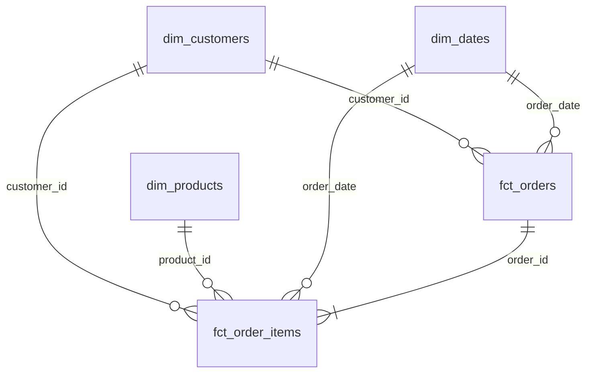
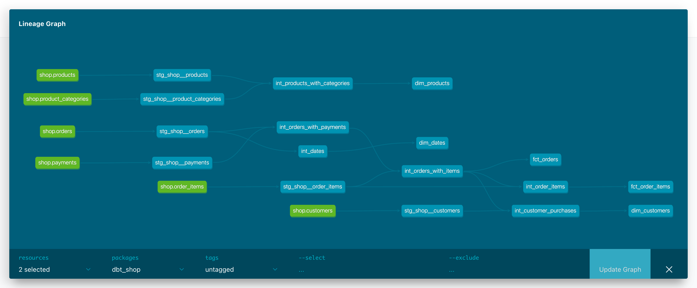

# ДЗ 1

Витрины магазина: dbt, Greenplum 7.

## Запуск

```bash
docker compose up -d
docker compose wait loader
docker compose build dbt
docker compose run --rm dbt deps
docker compose run --rm dbt build
```

## Модель данных

| Витрина | Одна строка | Бизнес-вопрос |
| --- | --- | --- |
| fct_orders | Заказ | Выручка по месяцам, средний чек по городам |
| fct_order_items | Товар в заказе | Выручка по категориям, возвраты по брендам |
| dim_customers | Клиент, включая не купивших | Доля покупателей по каналам |
| dim_products | Товар | Продажи по брендам и категориям |
| dim_dates | День | Продажи по месяцам и выходным |





Тестовые заказы исключены. Покупка подтверждена при paid и хотя бы одной успешной оплате без возврата.
Возврат - успешная операция с отрицательной суммой. Выручка считается по order_amount.
Сумма позиции: quantity * unit_price - discount_amount; items_count - число разных товаров.
Первая покупка выбирается по ordered_at, затем order_id. Категории разворачиваются рекурсивно.
Календарь покрывает все даты заказов. Ключ позиции строится через dbt_utils.generate_surrogate_key.

## Хранение в Greenplum

| Витрина | Распределение | Хранение и причина |
| --- | --- | --- |
| fct_orders | distributed by (order_id) | Колоночное: чтение отдельных полей, JOIN по заказу |
| fct_order_items | distributed by (order_id) | Колоночное: чтение отдельных полей, тот же ключ, что у заказов |
| dim_customers | distributed replicated | Строковое: 40 строк, копия на каждом сегменте |
| dim_products | distributed replicated | Строковое: 13 строк, частые JOIN с позициями |
| dim_dates | distributed replicated | Строковое: маленький календарь для обоих фактов |

У raw.orders, raw.order_items, raw.payments и фактов один ключ - order_id.
Он позволяет выполнять JOIN без пересылки строк между сегментами. Разные ключи могут вызвать пересылку.

## Тесты

unique, not_null, relationships, accepted_values, non_negative.
Сверяются позиции, источник, возвраты, переплаты и дата первой покупки.
Заказ 113: сумма 200, два списания по 200. Тест переплаты даёт WARN, выручка заказа - 200.

## Документация

```bash
docker compose run --rm dbt docs generate
docker compose run --rm --service-ports dbt docs serve --host 0.0.0.0 --port 8080 --no-browser
```

<http://localhost:8080>
